# Kvist & Bjælke ApS – Login Platform

Obligatorisk opgave i CDS.security og CDS.infrastructure, 3. semester, Datamatiker på SEA.
Lavet af Dom og Ahmed.

**Teknologier:** .NET 10 (Web API), Entity Framework Core med SQLite, React med TypeScript og Bun, nginx og Docker Compose.

## Sådan kører du projektet

1. `git clone https://github.com/AhmedCali/KvistBjaelke-Login.git`
2. Lav en fil `.env` i rodmappen med `JWT_KEY=` efterfulgt af en tilfældig tekst på mindst 32 tegn.
3. Kør `docker compose up -d --build`.
4. Åbn `http://localhost:8080`.

## Testbrugere

| Brugernavn | Adgangskode | Rolle |
|---|---|---|
| admin | Admin123! | admin |
| superuser | Super123! | superuser |
| user | User1234! | user |

---

## CDS.security

### 1. Description of the login platform

Kvist & Bjælke-login-platformen er en webapplikation, hvor brugere kan logge ind med brugernavn og adgangskode. Nye brugere kan oprette en konto via "Opret konto", og de får altid rollen user. Efter login vises en side med alle brugere, hvor knapperne til at oprette, redigere og slette brugere vises efter brugerens rolle.

Frontenden er lavet i React med TypeScript og Bun. Hele platformen kører i Docker: frontenden serveres af nginx, som også sender alle kald til `/api/` videre til backenden. Kun nginx er tilgængelig udefra, på port 8080.

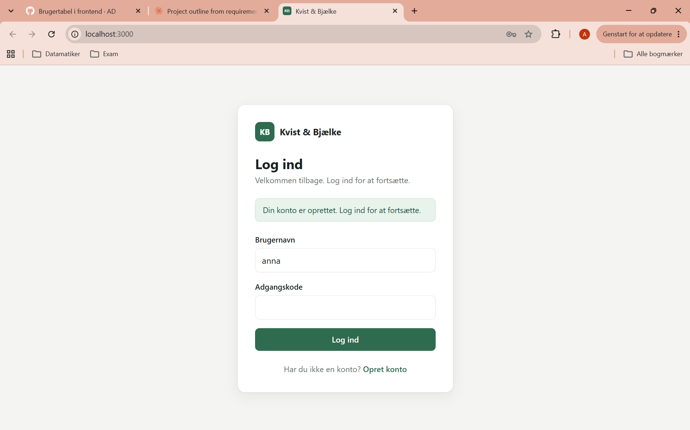

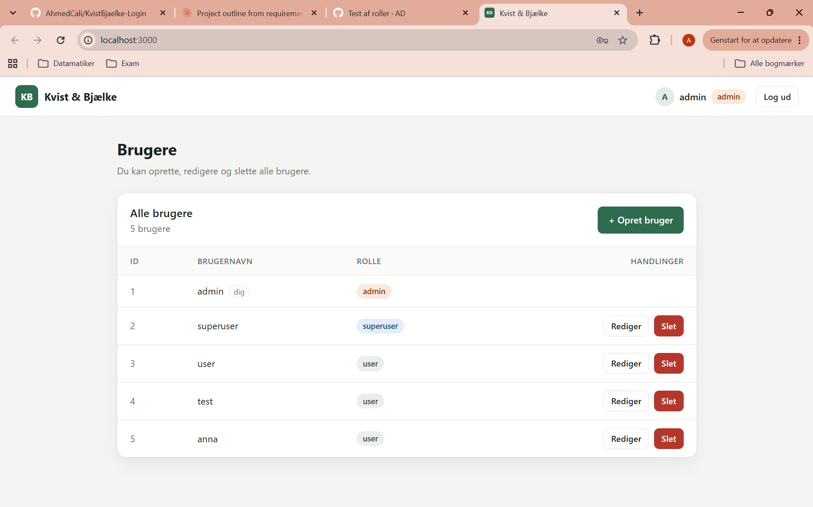

**API og database**

- Backenden er et .NET 10 Web API med controllers. `AuthController` håndterer register og login, og `UsersController` håndterer brugerlisten (hent, opret, ret og slet).
- Data ligger i en SQLite-database, som Entity Framework Core opretter ved første opstart.
- Er databasen tom, bliver tre testbrugere lavet: `admin`, `superuser` og `user`.
- Rollen bliver tjekket på serveren ved hvert kald. Brugere uden token får `401`, og brugere uden rettigheder får `403`.

**Hvorfor de her valg?**

Vi valgte .NET, fordi det har god støtte til login og roller, og EF Core bruger parametriserede forespørgsler, så vi undgår SQL injection. SQLite er nem at have i Docker og er nok til en opgave i den her størrelse. I en rigtig virksomhed ville vi bruge en rigtig database-server. Argon2id er det, OWASP anbefaler til adgangskoder, og med JWT slipper serveren for at gemme sessioner. nginx tager sig af frontenden og er det eneste, der er åbent udadtil, og Docker gør, at platformen kører ens hos os begge og på serveren.

### 2. Security features and alternatives

**Login (autentificering)**

Brugeren logger ind med brugernavn og adgangskode. Er koden forkert, får brugeren en fejl og ingen adgang.

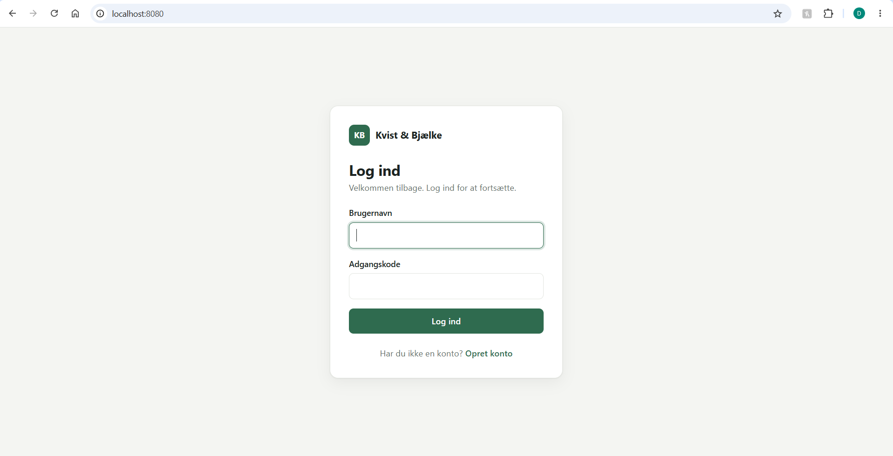

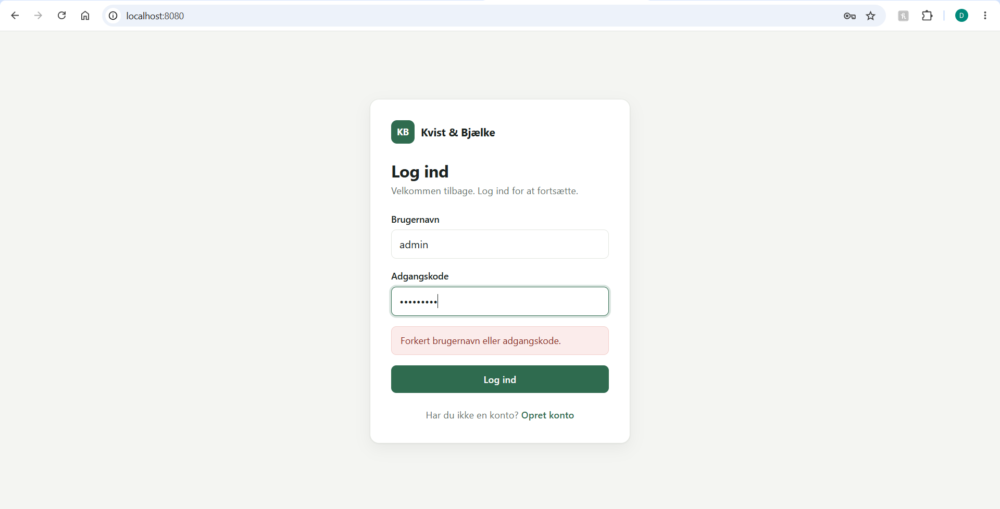

**Adgangskoder (Argon2)**

Billedet viser Users-tabellen i databasen. Adgangskoderne ligger ikke i klartekst, men som Argon2id-hashes. Hver hash indeholder algoritmen, et tilfældigt salt og selve hashen. Fordi hver bruger har sit eget salt, får to med samme adgangskode alligevel forskellige hashes. Selv hvis nogen får fat i databasen, kan de ikke læse koderne.

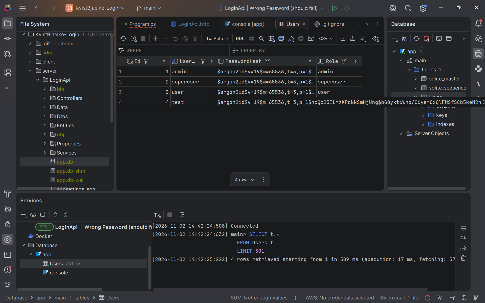

| Metode | Vurdering |
|---|---|
| **Argon2** (valgt) | Kræver meget hukommelse at gætte. Anbefales af OWASP. |
| bcrypt | God, men bruger lidt hukommelse. |
| scrypt | Bruger hukommelse, men er sværere at indstille. |
| PBKDF2 | Accepteret, men nem at accelerere med hardware. |
| SHA-256 | Bruges ikke. Den er lavet til at være hurtig. |

**JWT-token**

Efter login får brugeren et JWT-token, som er gyldigt i 1 time. Det indeholder id, brugernavn og rolle og er signeret med en hemmelig nøgle.

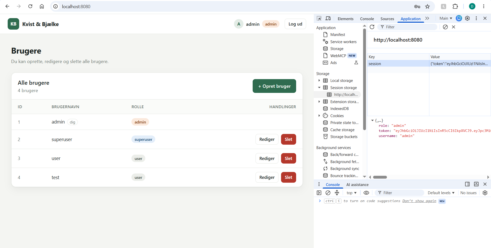

**Hvor tokenet gemmes**

Tokenet ligger i `sessionStorage` og bliver slettet ved log ud eller når fanen lukkes. Alternativerne er `localStorage` (bliver liggende) og en HttpOnly-cookie (beskytter mod XSS, men kræver CSRF-beskyttelse).

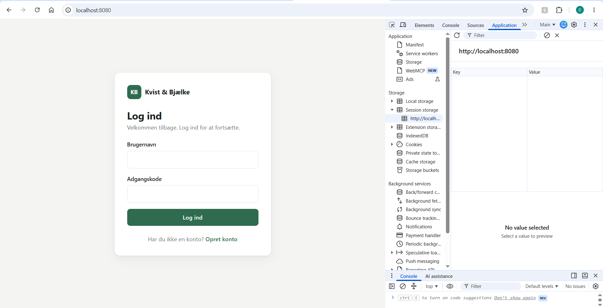

**Roller**

| Rolle | Må | Må ikke |
|---|---|---|
| Admin | Se, oprette, redigere og slette alle brugere | Slette sig selv |
| Superuser | Se alle brugere. Oprette, redigere og slette brugere med rollen user | Ændre eller slette superusers og admins, eller give nogen en højere rolle |
| User | Se listen over brugere | Oprette, redigere eller slette |

Admin ser knapper ved alle andre brugere:


Superuser kan kun oprette brugere med rollen user:

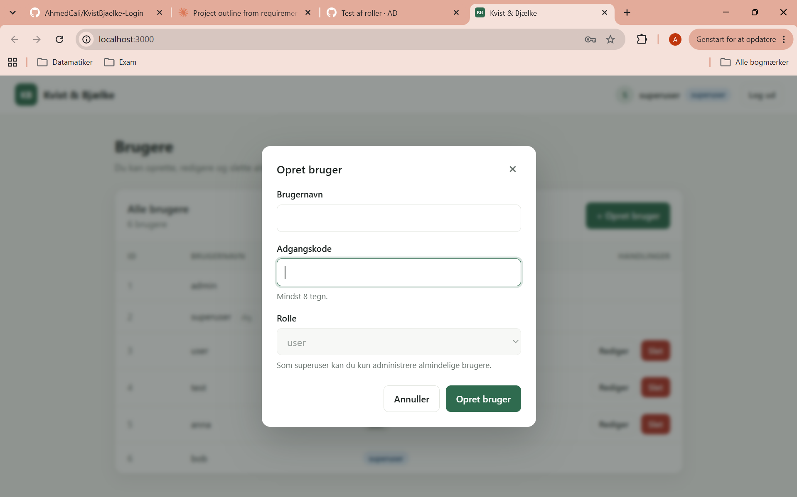

User har kun læseadgang:

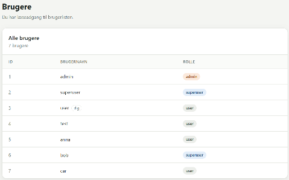

Frontenden skjuler de knapper, en rolle ikke må bruge. Det er dog kun for brugervenlighedens skyld. Den egentlige beskyttelse ligger i backenden: API'et tjekker rollen i JWT-tokenet ved hvert kald og svarer 401, hvis man ikke er logget ind, og 403, hvis rollen ikke må udføre handlingen. Tokenet er signeret med en hemmelig nøgle, så en bruger ikke kan ændre sin rolle uden at signaturen bliver ugyldig. I koden er reglen samlet i én funktion, `CanManage`, så den bruges ens ved oprettelse, rettelse og sletning.

Her ses serveren håndhæve reglerne i API-testen: admin kan oprette (`201`), en superuser kan ikke slette en admin (`403`), og en superuser kan slette en almindelig bruger (`204`).

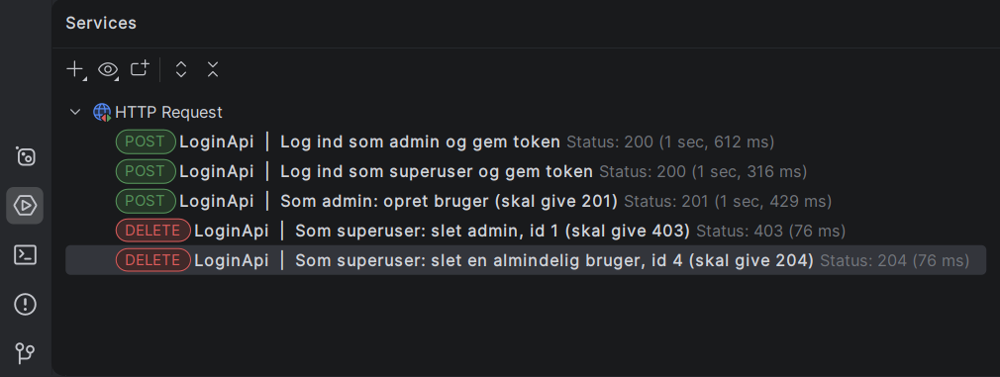

**Hemmelig nøgle**

JWT-nøglen ligger i `.env`, som ikke kommer på GitHub. Docker Compose sender den ind som miljøvariabel.

**Svagheder**

- Testbrugere med kendte koder i kildekoden.
- HTTP uden kryptering (der skal bruges HTTPS i produktion).
- Ingen grænse for antal loginforsøg.
- Alle kan oprette sig selv som `user`.
- Databasen har ikke et volume, så data forsvinder, hvis containeren slettes.

### 3. Link to GitHub repository

https://github.com/AhmedCali/KvistBjaelke-Login

---

## CDS.infrastructure

### 1. IP addressing plan

Vi bruger privat adresserum `10.5.x.0/…`. Tredje tal er det samme som VLAN-nummeret, så det er let at se, hvilket net en adresse hører til. VLAN 570 og 571 er givet af opgaven. De andre har vi selv valgt.

| VLAN | Net | CIDR | Gateway | Enheder | Adressering |
|---|---|---|---|---|---|
| 570 Klienter | 10.5.70.0 | /24 | 10.5.70.5 | 15 stationære og 10 bærbare | DHCP |
| 571 Servere | 10.5.71.0 | /24 | 10.5.71.5 | 3 servere | Statisk |
| 572 Printere | 10.5.72.0 | /28 | 10.5.72.5 | 3 printere | Statisk |
| 573 IP-telefoni | 10.5.73.0 | /27 | 10.5.73.5 | 12 IP-telefoner | DHCP |
| 574 Kameraer | 10.5.74.0 | /28 | 10.5.74.5 | 6 overvågningskameraer | Statisk |
| 575 Administration | 10.5.75.0 | /27 | 10.5.75.5 | Switche, router og 4 access points | Statisk |
| 576 Gæster | 10.5.76.0 | /24 | 10.5.76.5 | Gæsters telefoner og computere | DHCP |

Subnetmaske: `/24` er 255.255.255.0, `/27` er 255.255.255.224, og `/28` er 255.255.255.240. Gatewayen er `.5` i alle net. Det er samme mønster, som skolens net bruger.

**Hvorfor flere net?**

Gæster og kameraer skal ikke kunne nå serverne, og hvis en enhed bliver hacket, rammer det kun sit eget net. Det er også lettere at finde fejl, når hver slags enhed har sit eget net. Telefoner og kameraer fylder meget på nettet og skal ikke forstyrre medarbejdernes computere. Og firewallen kan have sine egne regler for hvert net, for eksempel at klienterne kun må nå serverne på bestemte porte.

**Statisk IP eller DHCP?**

Enheder, som andre skal finde, får statisk IP: servere, printere, kameraer og netværksudstyr. Enheder, der kommer og går, får DHCP: klienter, telefoner og gæster. Vi oplevede selv, at en server med DHCP skiftede adresse og blev utilgængelig. Tabellen viser vores forslag til virksomheden. I skolens lab er der ingen DHCP på VLAN 570, så vores testklient fik en statisk adresse (se afsnit 6).

Klient- og gæstenettene er `/24` med plads til 254 enheder. De mindre net har ca. det dobbelte af det, vi har brug for i dag.

### 2. Subnetting

Vi har valgt de to netværk, vi selv har sat op: klientnetværket (VLAN 570) og servernetværket (VLAN 571). Begge bruger /24.

| | VLAN 570 (Klienter) | VLAN 571 (Servere) |
|---|---|---|
| Netværksadresse | 10.5.70.0 | 10.5.71.0 |
| Subnetmaske | 255.255.255.0 (/24) | 255.255.255.0 (/24) |
| Broadcast-adresse | 10.5.70.255 | 10.5.71.255 |
| Brugbare adresser | 254 | 254 |
| Gateway | 10.5.70.5 | 10.5.71.5 |
| Enheder i dag | 25 (15 desktops + 10 laptops) | 3 servere |

/24 betyder, at de første 24 bit er netværksdelen, og de sidste 8 bit er til enheder. Det giver 2⁸ = 256 adresser. Den første (netværksadressen) og den sidste (broadcast) kan ikke bruges til enheder, så der er 254 brugbare. Gatewayen bruger én af dem.

VLAN 570: 25 enheder ud af 254 adresser er ca. 10 %, så virksomheden kan ansætte mange flere. Et /27 (30 adresser) ville være for lille allerede ved næste ansættelsesrunde.

VLAN 571: Med kun 3 servere er /24 egentlig større end nødvendigt. Et /28-netværk (14 brugbare adresser) ville være nok. Vi beholder alligevel /24, fordi netværket er givet på forhånd, der er rigeligt med private adresser, og vi slipper for at lave det om, hvis der kommer flere servere.

### 3. Network diagram

Netværksdiagrammet er valgfrit (opgave 2.5), og vi har ikke lavet et. IP-planen ovenfor viser, hvordan vi vil dele virksomhedens net op. Al trafik mellem VLAN går gennem routeren og firewallen. Klienterne (VLAN 570) må nå serverne (VLAN 571) på TCP-port 8000-8100.

### 4. Ubuntu Server on VLAN 571

Vi har oprettet vores helt egen virtuelle maskine, VM 125 – KvistBjaelke-Server, på skolens Proxmox-server. Vi har brugt Ubuntu Server-imaget i stedet for Ubuntu Desktop, da en server ikke har brug for en grafisk brugerflade. Jo færre installerede programmer, jo mindre er risikoen for angreb. Netværkskortet er forbundet til bridgen VLAN571, som placerer serveren på servernetværket. Vi har givet serveren 2 CPU-kerner, 4 GB RAM og 32 GB disk, primært fordi det kræver en del hukommelse at bygge .NET-backenden i Docker.

Vi har tjekket serverens IP-konfiguration med tre kommandoer. `ip a` viser, at netværkskortet ens18 har adressen 10.5.71.130/24, som ligger på VLAN 571. `ip route` viser, at serverens default gateway er 10.5.71.5. `ping ubuntu.com` med 0 % pakketab bekræfter, at serveren har forbindelse til internettet, og at DNS virker (det første ping-forsøg på skærmbilledet var en tastefejl).

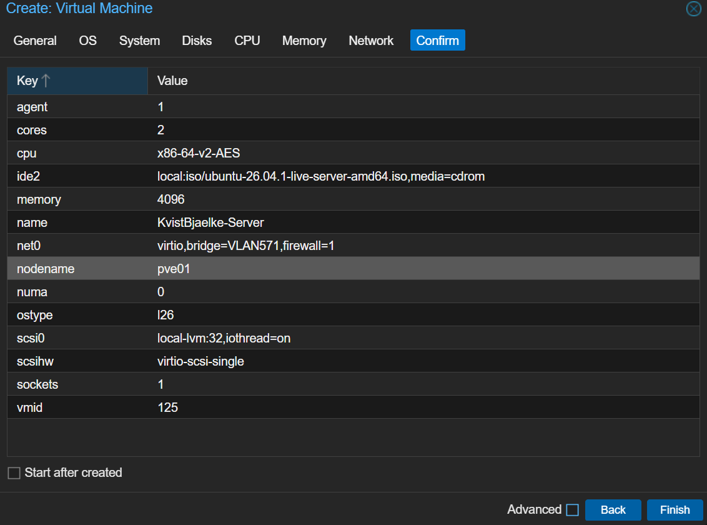

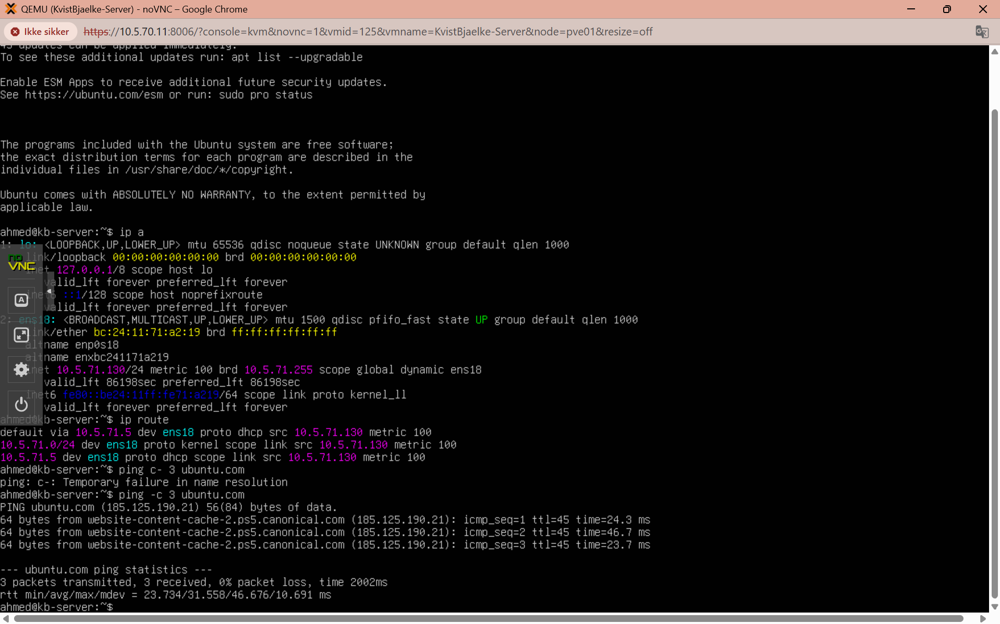

### 5. Docker installation and deployment

Først opdaterede vi serveren med `sudo apt update` og `sudo apt upgrade`. Derefter installerede vi Docker og Docker Compose med `sudo apt install docker.io docker-compose-v2`. `docker --version` og `docker compose version` viser de installerede versioner, og `systemctl status docker` viser, at Docker kører (active (running)) og starter automatisk, når serveren genstarter (enabled).

For at teste, at Docker virker, kørte vi `sudo docker run hello-world`. Docker hentede et testimage, startede en container og skrev "Hello from Docker!".

Vi hentede koden fra GitHub med `git clone` og oprettet en `.env`-fil med JWT-nøglen direkte på serveren. Derefter byggede og startede vi platformen med `sudo docker compose up -d --build`. Docker Compose bygger to containere: client (React-frontend serveret af nginx) og server (.NET-API'et). Til sidst viser outputtet, at begge containere er startet.

`sudo docker compose ps` viser, at begge containere kører (Up). Kun client-containeren er tilgængelig udefra, på port 8080 (0.0.0.0:8080->80/tcp). API'et er kun tilgængeligt internt, gennem nginx. `curl -I http://10.5.71.130:8080` giver HTTP/1.1 200 OK, som viser, at platformen kan nås på serverens IP-adresse og den valgte port.

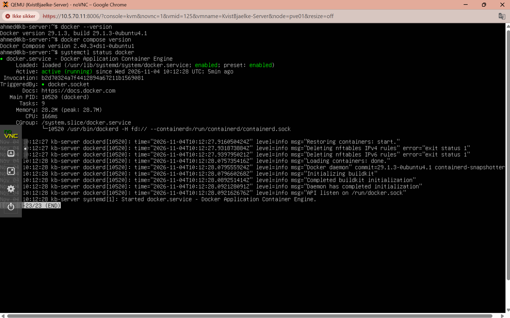

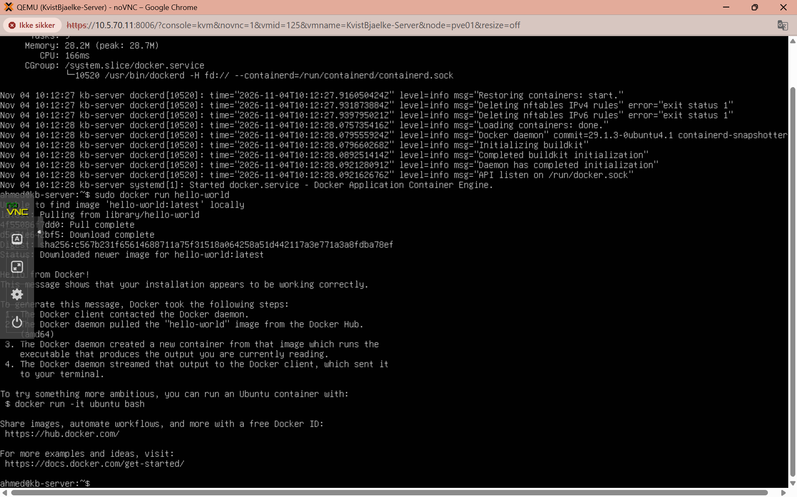

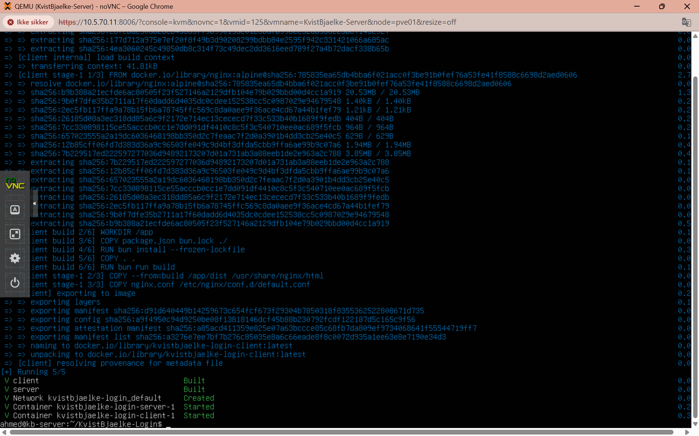

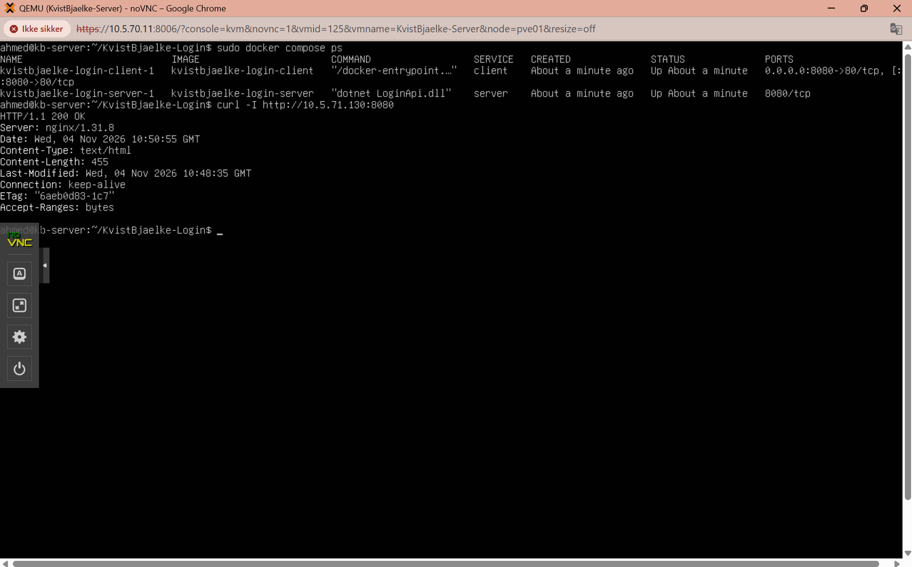

**Valg af port:** Vi valgte port 8080, fordi den ligger inden for det krævede interval 8000–8100, og fordi 8080 er en almindeligt brugt alternativ port til webtrafik. Kun denne ene port er åben udefra. Frontend og API deles om den samme port, fordi nginx sender alle kald til `/api/` videre til API'et.

**Docker Compose og `.env`**

```yaml
services:
  server:
    build: ./server
    environment:
      Jwt__Key: ${JWT_KEY}

  client:
    build: ./client
    ports:
      - "8080:80"
    depends_on:
      - server
```

- `client` (nginx med frontenden) er den eneste, der er åben udadtil, på port 8080. Den ligger i intervallet 8000-8100.
- `server` (.NET API) har ingen åben port og kan kun nås gennem nginx.
- `JWT_KEY` står i `.env`, som ikke ligger på GitHub, og sendes ind som miljøvariabel.

### 6. Client machine on VLAN 570

Klienten er en Ubuntu Desktop-maskine i Proxmox (VM 124), der spiller en medarbejders computer. Den sidder på `vmbr0` og er i VLAN 570 (`10.5.70.0/24`).

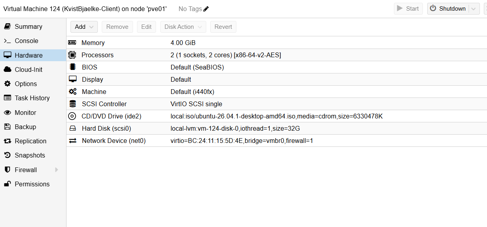

Der er ingen DHCP på nettet, så vi satte en statisk IP med `nmcli`:

```
sudo nmcli con mod netplan-ens18 ipv4.method manual ipv4.addresses 10.5.70.124/24 ipv4.gateway 10.5.70.5 ipv4.dns 10.5.70.5
sudo nmcli con up netplan-ens18
```

| | |
|---|---|
| IP-adresse | `10.5.70.124/24` |
| Gateway og DNS | `10.5.70.5` |

Opsætningen er tjekket med `ip a` og `ip route`, og gatewayen svarer på ping:

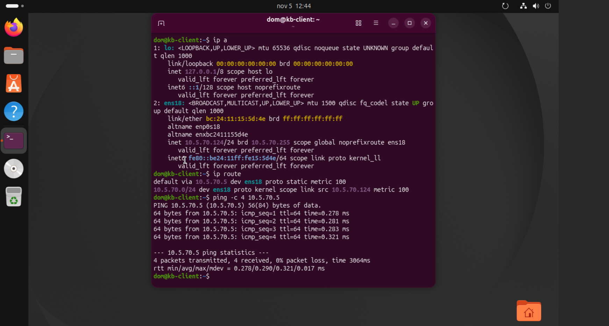

### 7. Communication between the client and the login platform

Klienten (`10.5.70.124`, VLAN 570) skal kunne nå login-platformen på serveren (VLAN 571). Da vi testede, havde serveren adressen `10.5.71.130`, og platformen kørte på port 8080.

**Ping virker ikke, og det er meningen.** Firewallen tillader kun TCP på port 8000-8100, så ping bliver droppet.

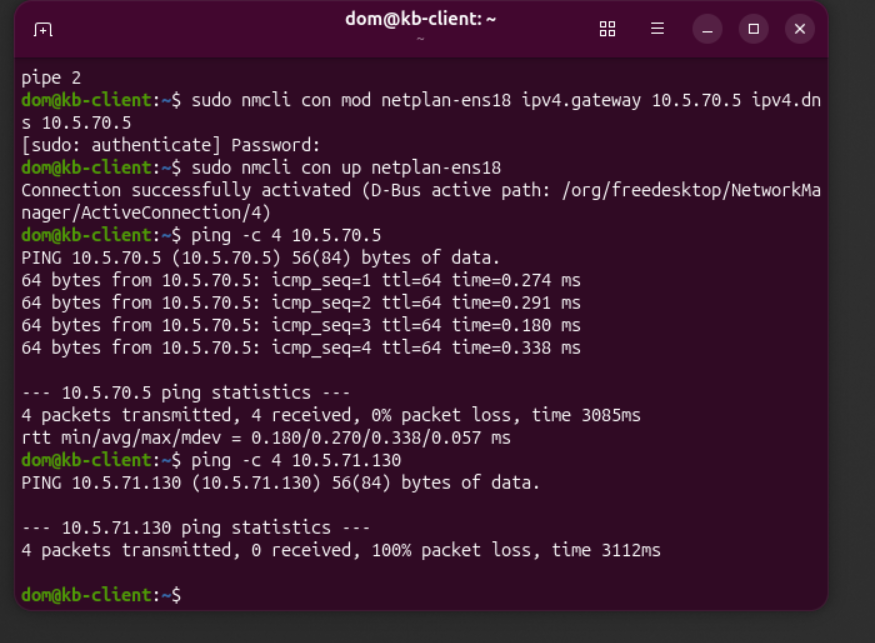

**Port 8080 kommer igennem.** Med `wget` får klienten svar fra serveren:

```
wget -S -O - http://10.5.71.130:8080
```

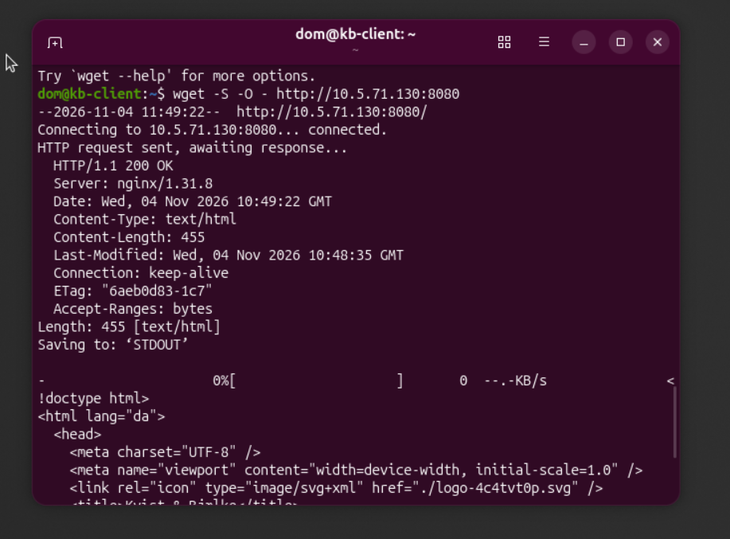

**Login fra browseren.** I Firefox på klienten åbnede vi `http://10.5.71.130:8080`. Her ses login-siden fra serveren:

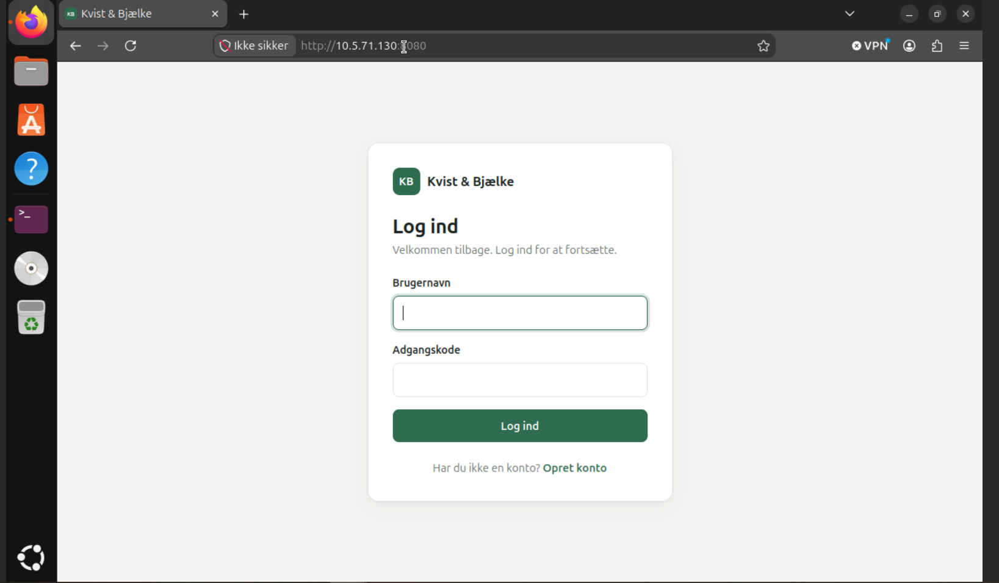

Efter login som `admin` vises brugerlisten, så platformen kan bruges fra klienten:

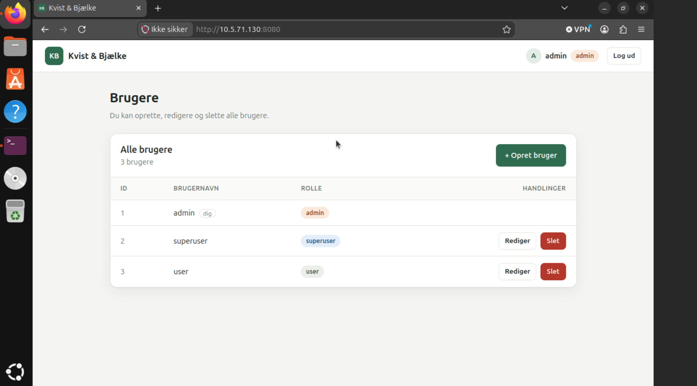

**Forklaring: VLAN, routing og firewall**

*Hvorfor er VLAN 570 og 571 adskilte netværk?*

Klienterne (VLAN 570) og serverne (VLAN 571) er delt op i to netværk for at øge sikkerheden og skabe orden. Hvis en medarbejders computer bliver inficeret, kan den ikke frit nå alle servere, fordi de ligger på et andet netværk. Det gør det også nemmere at styre, hvem der må tale med hvem.

*Hvorfor kræver trafik mellem VLAN'erne routing?*

En enhed kan kun tale direkte med enheder på sit eget netværk. Serveren har adressen 10.5.71.130/24 og klienten 10.5.70.124/24, altså to forskellige netværk. Derfor skal trafikken gennem en router. Det kan ses i `ip route`, hvor serveren bruger gatewayen 10.5.71.5 og klienten gatewayen 10.5.70.5.

*Hvad er firewallens rolle mellem netværkene?*

Firewallen sidder ved routeren og bestemmer, hvilken trafik der må passere mellem netværkene. I vores opsætning tillader den kun TCP-trafik fra VLAN 570 til VLAN 571 på porte 8000–8100. Det så vi i vores test: ping fra klienten til serveren fik 100 % pakketab, fordi ping ikke er TCP, mens wget på port 8080 fik svaret HTTP/1.1 200 OK.

*Hvorfor er det en fordel kun at åbne bestemte porte?*

Hver åben port er en mulig vej ind for en angriber. Ved kun at åbne de porte, der er brug for, gør man angrebsfladen så lille som muligt. Klienterne kan bruge login-platformen på port 8080, men kan ikke nå andre tjenester på serveren, f.eks. SSH eller databasen.

### 8. Challenges and solutions

**Klienten**

| Problem | Årsag | Løsning |
|---|---|---|
| Klienten fik kun en `169.254...`-adresse | Der er ingen DHCP-server på nettet | Vi satte en statisk IP med `nmcli` |
| `ping 10.5.70.1` gav "Destination Host Unreachable" | `.1` var et gæt fra vores IP-plan | Vi fandt den rigtige gateway `10.5.70.5` med `ip route` på Proxmox-serveren |
| Ingen forbindelse med VLAN-tag 570 på netkortet | `10.5.70.0/24` er det utaggede net på `vmbr0` | Vi fjernede tagget i Proxmox, og så virkede ping til gatewayen |
| `ping` til serveren fik ikke svar | Firewallen tillader kun TCP 8000-8100 | Vi testede med `wget` og browseren på port 8080 i stedet |
| `curl` var ikke installeret på klienten | Klienten har ikke internet | Vi brugte `wget`, som følger med Ubuntu |
| Serveren svarede ikke dagen efter (`No route to host`) | Serveren fik IP via DHCP, og adressen skiftede fra `.130` til `.131` | Vi fandt den nye adresse med `ip a` på serveren. En server bør have statisk IP. |
| Efter genstart gav `wget` "Connection refused" | Containerne starter ikke selv efter en genstart | Vi startede dem igen med `docker compose up -d`. En `restart: unless-stopped` i `compose.yaml` ville løse det. |

**Serveren**

| Problem | Årsag | Løsning |
|---|---|---|
| API'et ville ikke kunne starte på serveren uden JWT-nøgle | `.env`-filen med nøglen er bevidst ikke på GitHub (står i `.gitignore`), så den kom ikke med ved `git clone` | Vi genererede en ny nøgle direkte på serveren med `openssl rand -base64 48`, gemte den i `.env` og gav filen rettighederne 600, så kun vores bruger kan læse den |
| Frontenden og backenden brugte forskellige adresser til login (`/api/login` og `/api/auth/login`) | Vi byggede de to dele samtidig | Vi aftalte, at alle login-endpoints ligger under `/api/auth/` |
| Merge-konflikt i `Program.cs` og `AuthProvider.tsx` | Vi havde begge ændret de samme filer | Vi beholdt den version, der indeholdt begges ændringer, og pushede derefter |

---

## Brug af AI

Vi har brugt AI (Claude) som sparring og til idéer undervejs, for eksempel til at finde ud af, hvordan rollereglerne kunne bygges op, og hvordan vi kunne teste dem. Vi har også brugt den til at få forklaret begreber som VLAN og subnetting, til hjælp, når noget ikke virkede, og til at få idéer til opbygningen af denne README.

---

## Final reflection

**Hvordan hænger sikkerhed og infrastruktur sammen?**

Det hænger tæt sammen. Vores login er sikkert i koden med hashede adgangskoder, JWT og rollekontrol på serveren. Men det er først sikkert i praksis, når netværket også passer. Firewallen lader kun port 8080 komme igennem fra klienterne, og de to VLAN er adskilt, så en fejl i det ene net ikke rammer det andet. JWT-nøglen sendes ind udefra, så den ikke ligger i koden. Platformen kører dog stadig over HTTP, så trafikken kan læses på nettet. I en rigtig virksomhed skal det løses med HTTPS.

**Hvilke tekniske udfordringer havde vi?**

Netværket på klienten var det sværeste. Der var ingen DHCP, vi gættede på en forkert gateway, og VLAN-tagget gav ingen forbindelse. Vi lærte at tage det trin for trin med `ip a`, `ip route` og `ping` og at se på, hvordan Proxmox selv er sat op. På serveren var det JWT-nøglen, der ikke fulgte med fra GitHub, og at serverens IP skiftede, fordi den fik adressen via DHCP.

**Hvad lærte vi om at deploye en applikation på en server?**

At den samme `compose.yaml` kan køre platformen både lokalt og på serveren, hvis hemmeligheder som JWT-nøglen ligger uden for koden. Og at det ikke er nok, at containerne starter. Vi skulle også teste, at de blev ved med at køre, at porten svarede, og at det virkede fra et andet netværk.

**Hvad ville vi gøre anderledes i en rigtig virksomhed?**

Vi ville bruge HTTPS med et TLS-certifikat i nginx, så adgangskoder ikke sendes ukrypteret. Serveren ville også få en fast IP eller en DHCP-reservation, så klienterne altid kan finde den.
